<!-- Every card is an animated SVG drawn by scripts/build_cards.py and refreshed daily by
     .github/workflows/cards.yml. Gaps are baked into the SVGs, so keep this block free of blank
     lines and keep each row's cards on one line with no spaces between them. -->

<a href="https://github.com/BinaryBhakti"></a> 
 
 
<a href="https://github.com/BinaryBhakti?tab=repositories"></a><a href="https://github.com/BinaryBhakti?tab=repositories"></a><a href="https://x.com/imashmit_"></a> 
<picture><source media="(prefers-color-scheme: dark)" srcset="./assets/title-work-dark.svg" /></picture> 
<a href="https://github.com/BinaryBhakti/incidentdesk-devops-capstone"></a><a href="https://notebook-llm-ochre.vercel.app"></a><a href="https://paletteswift.netlify.app/"></a> 
<a href="https://white-boash-web.vercel.app"></a><a href="https://github.com/BinaryBhakti/Agent-CLI-Tool"></a><a href="https://github.com/BinaryBhakti/Website-Automation-Agent"></a>

<a href="https://x.com/imashmit_">x / twitter</a> &nbsp;/&nbsp; <a href="https://github.com/BinaryBhakti?tab=repositories">all repositories</a> &nbsp;/&nbsp; <a href="https://paletteswift.netlify.app/">palette swift</a>

